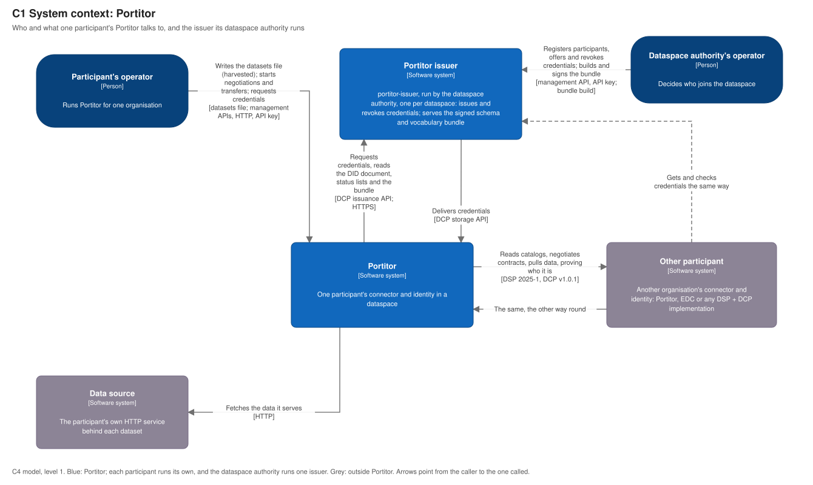
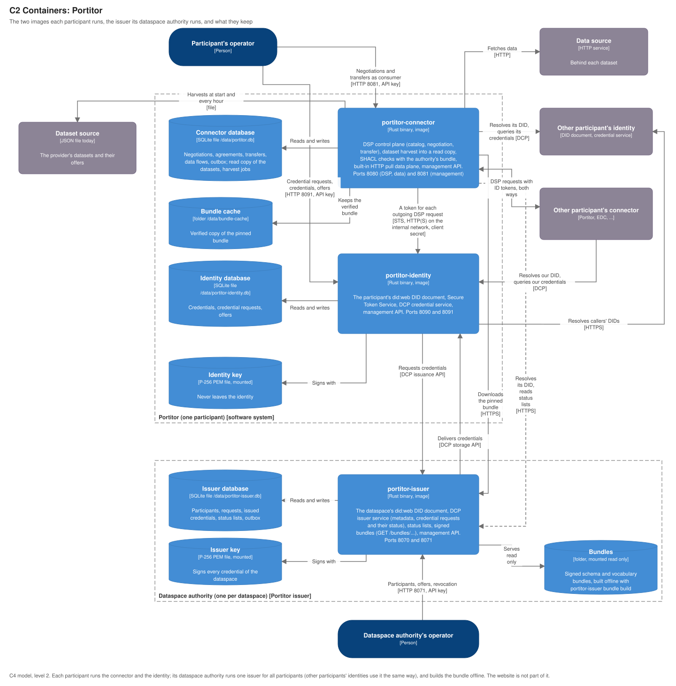
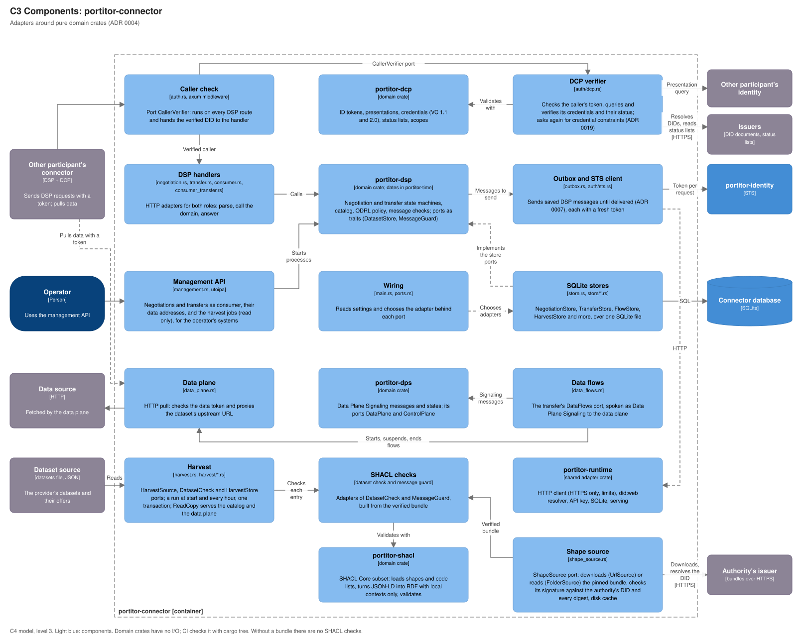
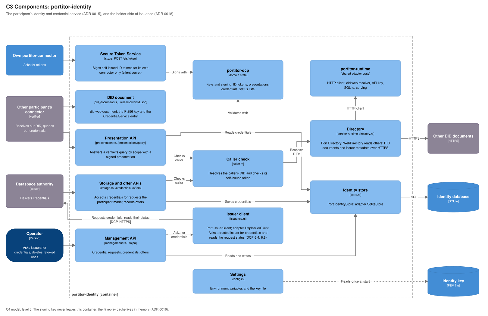
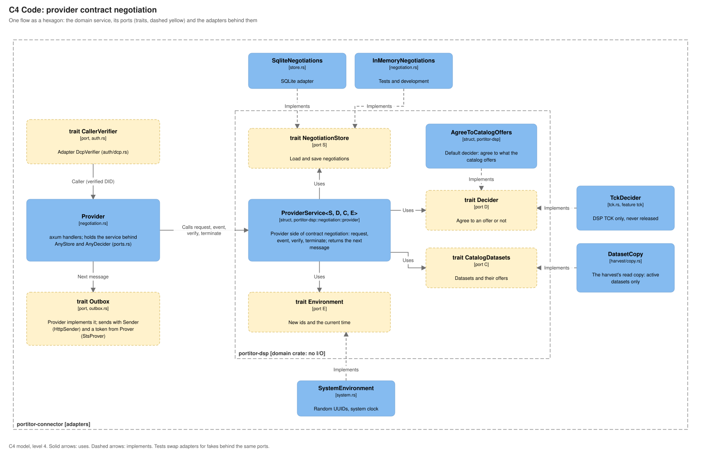

<!--
SPDX-FileCopyrightText: Portitor contributors

SPDX-License-Identifier: Apache-2.0
-->

# Architecture (draft)

Status: **draft for review**. Language: Rust ([ADR 0002](adr/0002-technology-stack.md), accepted).

## Goal

A small and fast connector that speaks the Dataspace
Protocol (DSP 2025-1) and the Decentralized Claims Protocol (DCP 1.0), with
few components and a simple deployment order.

## Architecture principles

Each principle has a short reason and a check, so a pull request can be
judged against it.

1. **Standards first.** Implement DSP, DCP, Data Plane Signaling and the
   Gaia-X Trust Framework as published; no private protocol extensions.
   Where a spec is silent, follow Eclipse EDC's behaviour and record it in
   an ADR. *Check:* every external endpoint cites its spec section; the
   DSP and DCP TCKs run in CI.
2. **Interoperability is tested, not assumed.** EDC and Simpl-Open are
   the reference counterparts ([ADR 0011](adr/0011-interoperability-targets.md)).
   *Check:* an interop test per protocol flow runs in CI from 0.5.
3. **Few components, one version.** One mono repo and one version for all
   components. Each component is a module of the repo and can ship as its
   own image. A new component needs an ADR. *Check:* the component list
   stays small and every component has a clear owner role and deployment
   step.
4. **Small and predictable.** No garbage-collector pauses on the request
   path, bounded memory, fast start. *Check:* the image size, memory,
   startup and p99 latency targets in ADR 0002 are measured on every
   release.
5. **Strong types at every boundary.** Each message type is its own type;
   invalid messages fail at parsing, not deep in the logic. Protocol state
   machines use exhaustive enums. *Check:* no untyped JSON outside the
   parsing layer.
6. **Plain JSON, schema-checked.** Messages are processed as plain JSON
   in compacted form, as both specs allow, and checked against the official
   JSON Schemas. No JSON-LD processor on the request path. *Check:* schema
   tests for every message type.
7. **Secure by default.** Deny by default, least privilege, no secrets in
   config files or images, an allow-list of signature algorithms (`ES256`,
   `PS256`), non-root and read-only containers. *Check:* OpenSSF Baseline
   level 1 and Scorecard in CI.
8. **Stateless processes, state in PostgreSQL.** Any instance can serve
   any request; restarts lose nothing. *Check:* tests restart the
   connector in the middle of a negotiation.
9. **Seams where specs are still moving.** Code that depends on a draft
   spec (Data Plane Signaling) sits behind an interface shaped like that
   spec, so it can be split out or updated without touching protocol code.
10. **Configuration through the environment.** Twelve-factor style; one
    optional file; sensible defaults for local use only. *Check:* the
    Docker Compose demo needs no file edits.
11. **Observable.** Structured JSON logs, metrics and traces
    (OpenTelemetry), health and readiness endpoints. *Check:* every
    protocol state change is logged with its process id.
12. **Hexagonal architecture.** Pure domain crates, ports as traits,
    adapters for HTTP, storage and DID resolution
    ([ADR 0004](adr/0004-hexagonal-architecture.md)). *Check:* domain crates
    have no I/O dependencies (`cargo tree` in CI).
13. **Simple over clever.** Prefer the standard library and a few
    well-maintained dependencies; each new dependency is justified in its
    pull request and passes the licence allow-list.

## Diagrams (C4 model)

The [C4 model](https://c4model.com/) in four levels, each zooming into the
one before. The files are draw.io diagrams saved as `.drawio.svg`: GitHub
shows them as pictures, and draw.io (desktop, web or the VS Code
extension) opens and edits the same file. Edit them in draw.io, never by
hand, and keep the format when saving. `scripts/check_docs.py` (run in
CI) checks that they still match the code: every crate and image is
drawn, every Rust file and type they name exists. Each release reviews
them ([RELEASING.md](RELEASING.md), "Documentation review").

**C1 System context**: who and what one participant's Portitor talks to.



**C2 Containers**: the two images one participant runs, and what they
keep.



**C3 Components**: inside each image, the adapters around the pure
domain crates ([ADR 0004](adr/0004-hexagonal-architecture.md)).





**C4 Code**: one flow, the provider side of contract negotiation, as a
hexagon: the domain service, the ports (traits) it uses and the adapters
behind them. The other flows (consumer negotiation, transfers) follow the
same pattern, with their ports in `portitor-dsp` and adapters in
`portitor-connector`; C4 level 4 is optional in the model, so only this
one is drawn.



## Components

One mono repo, one version. Each component is a **module** of the mono
repo (a crate in the Cargo workspace) and can ship as its **own image**.

**The split is decided in [ADR 0003](adr/0003-component-split.md):**
three images, split by who runs them and which keys they hold. Today each
image keeps its state in its own SQLite file; PostgreSQL, an external
dependency and not a Portitor image, comes later behind the same store
ports.

| # | Component (image) | Role | Mandatory? | Protocols |
|---|---|---|---|---|
| 1 | Database: one SQLite file per image today; PostgreSQL (external, not built by Portitor) later | State of negotiations, transfers, credentials | Mandatory | — |
| 2 | `portitor-identity` | Holds the participant's DID, keys and credentials (including Gaia-X credentials from 0.7); answers presentation queries | Mandatory for each participant, unless an external DCP wallet is used, or the participant uses Simpl-Open x509 only | DCP (credential service) |
| 3 | `portitor-connector` | Control plane: catalog, contract negotiation, transfer; verifies DCP presentations. The data plane is its own module, linked into the connector for 0.x (see below) | Mandatory | DSP, DCP (verifier) |
| 4 | `portitor-issuer` (planned for 0.6; until then a test-only tool) | Issues and revokes credentials (for example membership); builds and signs the schema and vocabulary bundle ([ADR 0005](adr/0005-schema-and-vocabulary-registry.md), proposed) | Optional: one per dataspace, run by the dataspace authority | DCP (issuance) |

### Images and crates in 0.5

Release 0.5 ships two images, built from one `Dockerfile` (one build
target per image) and released, signed and attested together
([RELEASING.md](RELEASING.md)). Until the PostgreSQL adapter exists, each
image keeps its state in its own SQLite file under `/data`.

```
 one participant runs both:

   +-----------------------------+        +----------------------------------+
   | portitor-connector          |  (1)   | portitor-identity                |
   | 8080 DSP, data plane        |------->| 8090 DID document, STS,          |
   | 8081 management API         |  STS   |      credential service          |
   | /data/portitor.db           |        | 8091 management API              |
   +-----------------------------+        | /data/portitor-identity.db       |
          | (2) DSP request + token        +----------------------------------+
          v                                        ^ (3) DID document,
   partner's connector ----------------------------+     presentation query

 crates (-> means "uses"):

   portitor-connector --> portitor-dsp, portitor-dps, portitor-dcp,
                          portitor-runtime
   portitor-identity  --> portitor-dcp, portitor-runtime
   portitor-runtime   --> portitor-dcp          (adapters: HTTP client,
                                                 did:web resolver, API key,
                                                 logging, shutdown)
   portitor-dsp, portitor-dps, portitor-dcp --> portitor-time
                                                (domain crates: no I/O)
```

- `portitor-connector`: binary; DSP control plane, built-in data plane,
  management API, SQLite store. Authenticates every DSP request with DCP
  and signs its own (ADR 0016).
- `portitor-identity`: binary; the participant's DID document, STS,
  credential service and management API (ADR 0015).
- `portitor-runtime`: library of adapters both binaries share, so they are
  not copied.
- `portitor-dsp`, `portitor-dps`, `portitor-dcp`, `portitor-time`: domain
  crates (ADR 0004); CI checks they have no I/O dependency.

The flow (DCP v1.0.1): (1) the connector asks its own identity's STS for
a self-issued ID token addressed to the partner; (2) it sends that token
with its DSP request; (3) the partner's connector checks the token against
the participant's DID document and queries the participant's credential
service for the credentials it needs. The connector never holds the
participant's private key.

In the connector (ADR 0016) this is two ports in `auth.rs`, with their DCP
adapters in `auth/dcp.rs` and `auth/sts.rs`:

- `CallerVerifier`, run by a middleware on every DSP route (provider
  endpoints and consumer callbacks; not `/.well-known/dspace-version`,
  `/health` or the data plane). The DCP adapter reads the
  `Authorization: Bearer` ID token, resolves the caller's `did:web` DID,
  validates the token (`portitor_dcp::validate_self_issued`: key with
  `capabilityInvocation`, `aud` = our DID, `iss` = `sub`, `exp`/`iat`/`nbf`,
  `jti` not replayed), then sends a `PresentationQueryMessage` for
  `PORTITOR_DCP_SCOPES` to the caller's credential service, with a token
  from our STS that carries the caller's access token. It verifies every
  presentation and credential (both profiles), fetches and verifies each
  status list credential (signed by the credential's issuer, fail closed),
  and requires a `MembershipCredential` from a trusted issuer about the
  caller. The verified DID goes to the handler as `Caller`; a refusal is
  HTTP 401 with a DSP error and no detail.
- `Prover`, used by the outbox before each outgoing DSP request: a fresh
  token from our STS with `aud` = the counter-party's DID (stored with the
  negotiation or transfer when it started, never taken from an incoming
  message) and `bearer_access_scope` = `PORTITOR_DCP_SCOPES`. Tokens are not
  cached: each `jti` is accepted once.

The domain binds each negotiation and transfer to its counter-party: as
provider, only the DID that started it may send to or read it; as
consumer, only the provider it was started with may use its callbacks. At
start the connector resolves its own DID document and checks that its STS
signs for it. Tests use fake ports; the `tck` build maps the DSP TCK's
fixed header to the TCK participant.

The website is a static site published by GitHub Pages; it is not deployed
by participants.

## Deployment order

1. Storage: a volume for each image's SQLite file (PostgreSQL later).
2. Identity: publish the `did:web` document over HTTPS.
3. Issuer (only the dataspace authority): issue a membership credential to
   the participant's identity. For Gaia-X, the participant also obtains a
   Compliance credential from a Gaia-X Digital Clearing House.
4. Connector: point it at the identity and the database.

## Data plane: inside the connector or separate?

**Decided (maintainer, 2026-11-11): option A, inside the connector, behind
an internal interface that follows Eclipse Data Plane Signaling.** The
reasoning is kept below.

**What each part does.** The control plane negotiates: catalog, contract,
and the start and end of a transfer (DSP). The data plane moves the bytes,
for example by serving a file over HTTP to the consumer, with a short-lived
token that the control plane issued.

**Option A: in the connector's process (decided for 0.x).** The data plane
is its own module, but runs inside the connector's process and image: one
deployment step. No internal API to secure or version. The cost:
the data traffic and the protocol logic share CPU, memory and the network
exposure; you cannot scale them apart; a bug in data handling can take down
negotiation.

**Option B: separate data plane service.** Scales and fails independently,
can sit in another network zone near the data, and allows several data
plane types (HTTP, S3, Kafka). The cost: a fourth component, and an
internal control-to-data-plane API. DSP does not define that API. The
Eclipse Data Plane Signaling spec does, but it is still incubating with no
release. EDC (and so Simpl-Open) is moving to Data Plane Signaling, so
building our own interface now risks rework.

**Decision.** Ship option A in 0.4, with the data plane behind an internal
interface that follows Eclipse Data Plane Signaling **v1.0-RC4** (tag of
27 Aug 2026 in `eclipse-dataplane-signaling/dataplane-signaling`): the
same data flow state machine, the same messages (`prepare`, `start`,
`started`, `suspend`, `resume`, `terminate`, `completed`, `errored`) and
the same `DataAddress` shape. In-process, these are function calls; the
HTTP endpoints (`/dataflows/...` on the data plane, `/transfers/:id/dataflow/...`
on the control plane) are added only when we split. We track the spec until
its 1.0 release and record each update in the changelog. When that spec is
released, split it out as an optional component (option B) without
changing the connector's protocol code. Interoperability with EDC and
Simpl-Open is not affected either way: other connectors only see DSP and
the data endpoint, never our internal split.

**In code (0.4).** The domain crate `portitor-dps` holds the signaling
messages, the data flow state machine and two ports: `DataPlane` (what the
control plane asks: `prepare`, `start`, `started`, `suspend`, `resume`,
`terminate`, `completed`, `status`) and `ControlPlane` (what the data plane
reports: `prepared`, `started`, `completed`, `errored`). The optional
agreement retrieval endpoint and registration are left out: one built-in
data plane needs neither.

What implementing v1.0-RC4 showed (to report to the Data Plane Signaling
project, and to settle in ADR 0013 where it affects us):

- Five examples (start, started, resume, status and the base data address
  example) fail the specification's own schemas: their data addresses lack
  the `@type` fields that the DSP `DataAddress` schema requires, and two
  are an empty `{}`.
- The `DataFlowStartMessage` example is an HTTP pull with a `dataAddress`,
  while the text says a data address on `start` for a pull "MUST result in
  a HTTP 4xx Client Error".
- Resume: the specification lets only the party that suspended resume;
  DSP 2025-1 lets either party start a suspended transfer again.
- The HTTP transfer profile (`profiles` repository, no release yet) sets
  `endpointType` to `https://w3id.org/dspace-sig/profile/http-pull` and
  requires HTTPS endpoints; DSP examples and the TCK use
  `https://w3id.org/idsa/v4.1/HTTP` and the format `HTTP-PULL`. Which value
  Portitor sends over DSP is decided in ADR 0013 (0.4 PR 3).
- Starting a suspended pull transfer again from the provider side: DSP
  requires a data address in the provider's start message, but Signaling
  has no way to ask the data plane for a new one. Portitor's built-in data
  plane gives the flow a new token (ADR 0014).
- The diagram "Consumer Pull – Consumer Suspend/Start" shows the provider
  sending a `TransferStartMessage` with a data address back after the
  consumer started the transfer again. The DSP TCK refuses that message
  (its consumer is already STARTED), and Portitor does not send it
  (ADR 0013).

What the transfer work showed about the DSP TCK v1.0.2 (to report to the
TCK project):

- Its consumer moves a transfer to REQUESTED only after it reads the
  provider's answer to the request, and its start handler removes itself
  after the first start message, even one it refused. A provider that sends its start message at once can hit
  the gap; every retry then gets 404. Portitor's TCK build waits 300 ms
  before a start message (ADR 0014).
